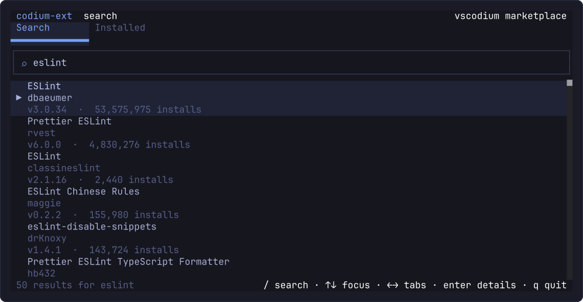
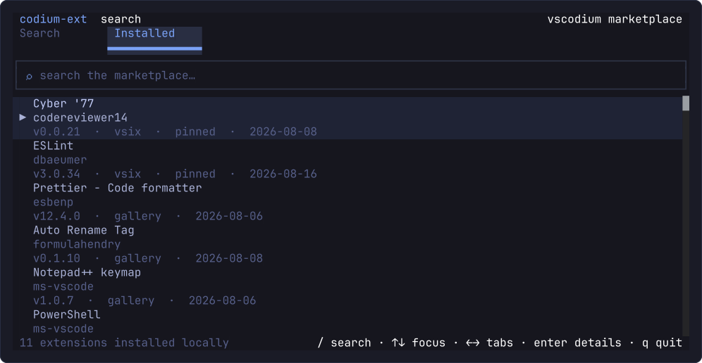
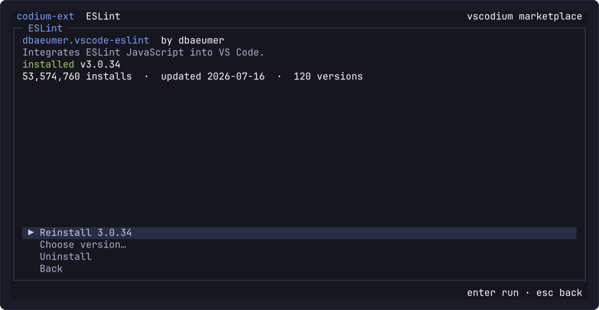
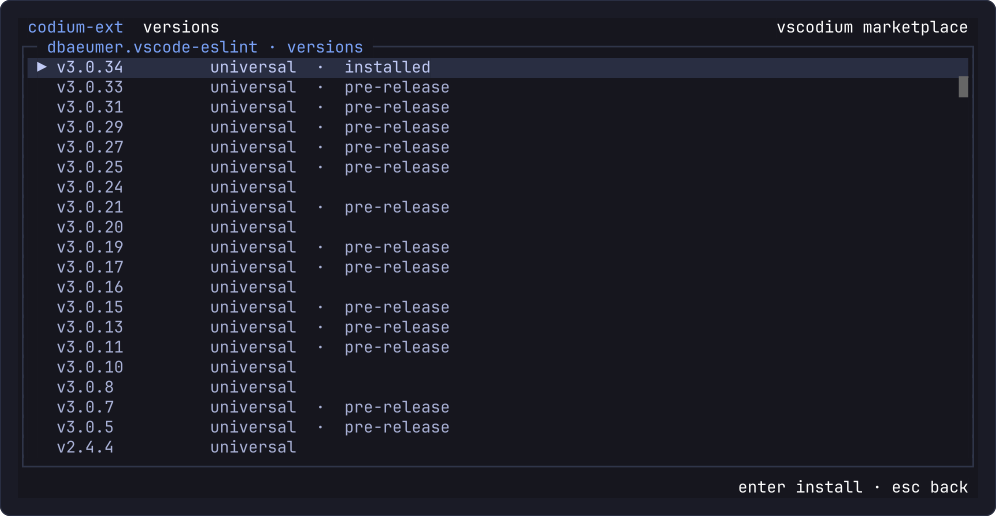

# codium-ext

A terminal UI for managing Microsoft Marketplace extensions in
[VSCodium](https://github.com/VSCodium/vscodium).

Built with [`@opentui/core`](https://opentui.com) (Zig core + TypeScript bindings) on Node 26.
Each install follows one pipeline: **download the `.vsix` → `codium --install-extension <file>` → delete the `.vsix`**.

## Why

VSCodium ships with [Open VSX](https://open-vsx.org) as its extension gallery — the Microsoft Marketplace
license does not allow non-Microsoft builds to use it. So any extension published only to the Microsoft
Marketplace (or one whose Open VSX mirror lags behind) never appears in VSCodium's Extensions tab, and
there is no built-in way to search for it.

`codium-ext` queries the Microsoft Marketplace directly and hands the `.vsix` to the `codium` CLI, which
installs it like any other extension. The result is the same on-disk extension an Extensions-tab install
would produce, so updates, uninstall, and `--list-extensions` all keep working.

## Features

### Search

Type a query and press enter. Results come straight from the Microsoft Marketplace and render as three-line
rows — display name, publisher id, then latest compatible version with its install count. The tab strip
switches between the Marketplace search and the extensions already installed locally.



### Installed

The installed list comes from `codium --list-extensions --show-versions` and is enriched from
`extensions.json` in the VSCodium extensions directory (`~/.vscode-oss/extensions` on macOS/Linux,
`%USERPROFILE%\.vscode-oss\extensions` on Windows) for source, pinned state, and install date. Rows show
display name (from the extension's `package.json`), publisher id, then version · source · pinned · date.



### Details

Pick a result to see its description, install count, last update, installed version, and how many versions
the publisher ships. Actions are `Install latest` (or `Reinstall <version>` when that version is already
present), `Choose version…`, and `Uninstall` — the last is confirmed first, then runs
`codium --uninstall-extension` and polls until the extension disappears from the list.



### Choose version

The version picker lists every build matching this machine — `universal` plus the native target
(`linux-x64`, `darwin-arm64`, `win32-x64`, …) — newest first, tags prereleases, and marks the installed one.



### Install

Installs run in a dedicated screen with the live phase, a progress bar, and the piped `codium` output.
`esc` cancels cooperatively: the download stops, the work directory is removed, and no partial extension
is left behind.

## Requirements

- Node.js **26.4+** (OpenTUI loads its native core through FFI, so the launcher passes `--experimental-ffi`)
- `codium` on `PATH` (`codium.cmd` on Windows)
- `bsdtar` or `unzip` for VSIX validation — Linux has `unzip` or `bsdtar`, macOS ships `bsdtar`, and
  Windows 10+ ships `tar.exe`, which the installer also uses

Supports Linux, macOS, and Windows on x64 and arm64.

## Run

```sh
npm install
npm run dev
```

## Keys

| Key | Action |
| --- | --- |
| `/` | focus the search box |
| `enter` | search · open the selected extension · run the selected action |
| `↑` | tabs → search bar · search bar → tabs · list → search bar (only at the top; above that it scrolls) |
| `↓` | tabs → search bar · search bar → list |
| `←` `→` | switch tab while the tab strip is focused; the list follows the selected tab |
| `esc` | leave the search box · go back one screen · cancel an install |
| `ctrl+r` | refresh the installed list |
| `q` | quit (not while typing in the search box) |

## CLI

`bin/codium-ext.js` is the CLI entry point. Link it once to get a `codium-ext` command on `PATH`:

```sh
npm link                                            # npm prefix is user-writable (nvm, volta, ~/.npm-global)
ln -sf "$PWD/bin/codium-ext.js" ~/.local/bin/codium-ext   # npm prefix is system-owned
```

On Windows, `npm link` creates `codium-ext.cmd` in the npm global bin directory.

```sh
codium-ext --list
codium-ext --probe dbaeumer.vscode-eslint
codium-ext --install dbaeumer.vscode-eslint            # latest stable
codium-ext --install dbaeumer.vscode-eslint@3.0.24     # exact version
codium-ext --install <id> --dry-run                    # resolve only
codium-ext --list --extensions-dir /tmp/ext --user-data-dir /tmp/data
codium-ext --help
```

Without linking, `./bin/codium-ext.js …` (or `node bin\codium-ext.js …` on Windows) does the same.

## Layout

```
bin/
  codium-ext.js    CLI entry point (passes --experimental-ffi to src/main.ts)
src/
  main.ts          CLI entry and headless modes
  models.ts        pure data types: version ordering, platform selection, list parsing
  marketplace.ts   extensionquery search/versions and streamed download with sha256 check
  installed.ts     codium --list-extensions + extensions.json metadata
  installer.ts     work dir, VSIX validation, codium subprocess, post-install verification
  log.ts           per-platform cache directory and app.log
  theme.ts         Tokyo Night palette, square borders
  ui/              app shell (header/body/footer, screen stack) and the main, details,
                   version, install, and confirmation screens
tests/             node:test — models, marketplace parsing, installer pipeline, UI via createTestRenderer
docs/
  architecture.md  module map, data flow, install pipeline, and invariants
screenshots/       rendered frames used by the Features section
```

Downloads and installs happen under a per-user cache directory (`~/.cache/codium-ext-tui` on Linux,
`~/Library/Caches/codium-ext-tui` on macOS, `%LOCALAPPDATA%\codium-ext-tui\cache` on Windows) in
`work/<uuid>/`, which is removed in a `finally` block. Each install start also sweeps work directories
older than an hour. A log is written alongside it in `app.log`.

## Tests

```sh
npm test          # node --experimental-ffi --test tests/*.test.ts
npm run typecheck # tsc --noEmit
```

## Marketplace notes

- `POST /_apis/public/gallery/extensionquery`, no cookies required.
- `flags: 2423` is required; smaller values (e.g. the browser's `870`) return a single version per extension.
- A search response carries only one version entry per extension, so version lists are always re-fetched by exact id.
- The gallery returns one entry per target platform. Only `universal` and the host's native build are kept,
  preferring the native build (`linux-x64`, `darwin-arm64`, `win32-x64`, …).
- `?targetPlatform=` is appended to the download URL **only** for platform-specific builds; adding it to a universal
  build returns 404.
